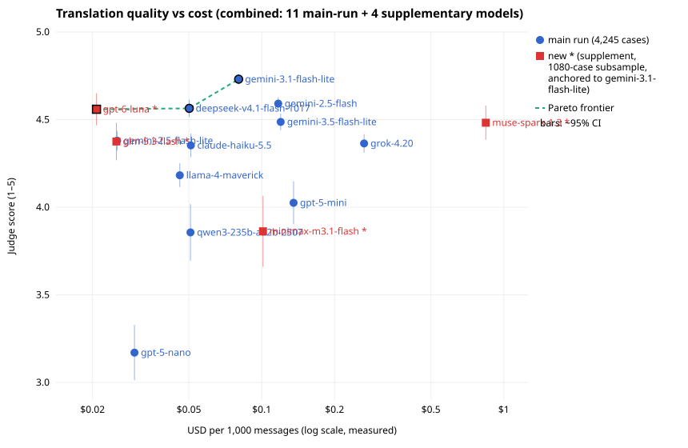

# The Cost-Performance Pareto Frontier for LLM Translation

Title options:

1. Translation quality against cost for 15 LLMs in 72 languages
2. I measured 15 cheap LLMs as chat translators
3. Picking a translation model for a chat app at eight cents per 1,000 messages

Draft status: first draft. Items marked [CHECK] need verification and items marked [BLAKE: ...] need your input.

---

I ran 4,245 translation cases across 72 languages through 15 LLMs and had one judge model score every output. GPT-6 Luna, DeepSeek V4.1 Flash and Gemini 3.1 Flash-Lite sit on the cost-quality frontier. GPT-6 Luna is the cheapest at $0.021 per 1,000 messages. DeepSeek V4.1 Flash costs $0.050. Gemini 3.1 Flash-Lite costs $0.080 and has the highest score. Every other model I tested is both more expensive and worse than one of those three.

The average scores are close: 4.56, 4.56 and 4.73 on a 1-5 scale. The critical-error rates are not. On the same subsample, Luna made a serious mistake on 7.9% of messages, DeepSeek on 4.4% and Gemini 3.1 Flash-Lite on 1.7%. For my use case, that difference outweighs the cost difference.

## Why I cared

I'm building say.as, a pass-the-phone translation chat app. Two people who don't share a language sit together, and each types or speaks in their own language. The app translates each message for the other person. [BLAKE: a sentence or two on where the idea came from or who it's for.]

The messages in an app like that don't look like benchmark sentences. They are short and informal, with typos, missing accents, slang, and pronouns that refer back three messages. Each message is a separate API call, so per-message cost adds up, and one mistranslated message in the middle of a conversation does more damage than a slightly stiff one. I wanted to know which model to use and what I'd give up by going cheaper.

I picked Gemini 3.1 Flash-Lite for the app. This post is the data behind that choice.

## Method

**Cases.** Each of the 72 non-English languages gets up to 40 benchmark cases and 20 chat cases, English into the target language. Benchmark items come from WMT24++ where available, preferring the social and speech domains and shorter segments, then NTREX-128, then Tatoeba. FLORES+ is gated on Hugging Face and I didn't use it. Languages with fewer than 40 clean segments use every segment available, so a few have fewer cases. Bhojpuri has 30 and Sundanese 34. The chat items are synthetic multi-turn conversations written by Claude Opus 5.5, with the kind of typos and slang the app will see. That gives 2,805 benchmark cases and 1,440 chat cases, 4,245 in total.

**Translation.** Every model got the same system prompt, which asks it to act as an interpreter in a live conversation, use the history for pronouns and tone, forgive typos and missing accents, and output only the translation. Chat items include the conversation history.

**Judging.** One judge, Claude Opus 5.5, scored each case with all candidate translations shown together, shuffled and anonymous. It gave each one an integer from 1 to 5 for meaning, naturalness and handling (repairing typos, slang, autocorrect, diacritics, code-switching and honorifics), plus a critical-error flag. A critical error is a wrong or reversed meaning, the wrong target language, a flipped negation, a wrong number, dose or price, or an offensive mistranslation. Awkward wording alone doesn't count. The score is the mean of the three 1-5 ratings. The judge saw the reference translation for benchmark items, and chat items have none.

**Statistics.** Each language counts equally in the overall mean. The 95% intervals come from a hierarchical bootstrap that resamples languages, then cases within each language (2,000 draws). A model is off the frontier only if another model that costs no more is clearly better. Clearly better means the paired bootstrap interval of the difference excludes zero.

**Cost.** Cost is what OpenRouter actually billed (`usage.cost`) for each successful translation, including reasoning tokens, scaled to 1,000 messages. It doesn't include judging.

**The supplement.** After the main run of 11 models, I added four newer ones: GPT-6 Luna, GLM 5.3 Flash, MiniMax M3.1 Flash and Muse Spark 1.3. Rate limits on a new OpenRouter account kept Luna and Muse Spark to 20 requests per minute, so I judged all four on a fixed subsample of 1,080 cases (10 benchmark and 5 chat per language). Gemini 3.1 Flash-Lite and DeepSeek were included as anchors in the same judge prompts. Each new model is placed on the main-run scale as Gemini's full-run mean plus its paired gap to Gemini on the subsample. As a check, the Gemini-DeepSeek gap was +0.12 under the main judge on that subsample and +0.14 in the supplement pass.

The whole run cost $39.71 on OpenRouter: $10.67 for drafting chat cases, $5.23 for translations and $23.81 for judging. The supplement added $3.97. [CHECK: the $3.97 supplement figure comes from my notes, not a file in the repo; confirm it against the ledger.]

### Limitations

- **One LLM judge.** No native speaker reviewed any of these outputs. The scores show what Opus 5.5 thinks of the translations, and for low-resource languages its own judgment may be weak.
- **Family bias.** A judge can favor outputs that resemble its own. Opus 5.5 is an Anthropic model, and Claude Haiku 5.5 landed mid-table, so there's no obvious favoritism, but I didn't test for it with a second judge in this run. [CHECK: the earlier pilot used two judges; say whether they agreed.]
- **English source only.** Every case translates out of English. The app translates in both directions, and I didn't measure the reverse.
- **Noisy per-language cells.** With up to 60 cases per language in the main run, and 15 per language in the supplement, single-language numbers can move a lot.
- **Listwise scoring is relative.** Candidates are scored side by side, so a model's absolute score depends a little on who else is in the prompt. The anchor check suggests the drift is small, but it isn't zero.
- **Language varieties.** WMT24++ uses specific locales, such as Mexican Spanish and Egyptian Arabic, and I treated each as the whole language.

## Results

Main run, all 4,245 cases:

| Model | Mean (95% CI) | Critical | $ / 1k msgs |
| --- | --- | ---: | ---: |
| Gemini 3.1 Flash-Lite | 4.73 (4.70-4.76) | 0.9% | $0.080 |
| Gemini 2.5 Flash | 4.59 (4.56-4.62) | 1.7% | $0.117 |
| DeepSeek V4.1 Flash | 4.56 (4.51-4.61) | 2.7% | $0.050 |
| Gemini 3.5 Flash-Lite | 4.49 (4.44-4.53) | 2.9% | $0.120 |
| Gemini 2.5 Flash-Lite | 4.38 (4.32-4.43) | 4.5% | $0.025 |
| Grok 4.20 | 4.36 (4.31-4.41) | 3.4% | $0.265 |
| Claude Haiku 5.5 | 4.35 (4.28-4.42) | 4.2% | $0.051 |
| Llama 4 Maverick | 4.18 (4.11-4.25) | 5.7% | $0.046 |
| GPT-5 mini | 4.03 (3.89-4.15) | 9.2% | $0.135 |
| Qwen3 235B A22B | 3.86 (3.68-4.00) | 14.4% | $0.051 |
| GPT-5 nano | 3.17 (3.02-3.32) | 26.1% | $0.030 |

Supplement, 1,080-case subsample, scores placed on the main-run scale:

| Model | Score (main scale) | Critical (subsample) | $ / 1k msgs |
| --- | --- | ---: | ---: |
| Gemini 3.1 Flash-Lite (anchor) | 4.73 | 1.7% | $0.080 |
| DeepSeek V4.1 Flash (anchor) | 4.56 | 4.4% | $0.050 |
| GPT-6 Luna | 4.56 ±0.09 | 7.9% | $0.021 |
| Muse Spark 1.3 | 4.48 ±0.10 | 9.0% | $0.843 |
| GLM 5.3 Flash | 4.38 ±0.11 | 6.5% | $0.025 |
| MiniMax M3.1 Flash | 3.86 ±0.20 | 18.5% | $0.101 |

The anchors' critical-error rates are higher on the subsample than in the full run (Gemini 1.7% against 0.9%, DeepSeek 4.4% against 2.7%). When comparing the new models with the anchors, use the subsample column.

A few things stood out to me.

**Newer and bigger didn't win.** Gemini 3.5 Flash-Lite is a newer version than 3.1 Flash-Lite and costs half as much again per message ($0.120 against $0.080), yet it scored 0.24 lower (95% CI 0.21-0.29). Grok 4.20 is the most expensive model in the main run at $0.265 per 1,000 messages and scored 4.36. Muse Spark 1.3 costs $0.843 per 1,000 messages, about ten times the Gemini price, because its reasoning can't be turned off on OpenRouter, and it still scored lower.

**Luna's place on the frontier is narrow.** GPT-6 Luna matches DeepSeek's mean (a paired gap of -0.03, CI -0.14 to 0.07) at less than half the price. Its critical-error rate is the highest of the three frontier models, though. Luna and Gemini 2.5 Flash-Lite were never judged in the same prompt, so the call that Luna scores higher rests on a conservative combined interval rather than a direct comparison.

**Benchmark and chat agree on the winner.** Gemini 3.1 Flash-Lite had the highest mean on both the benchmark cases (4.70) and the chat cases (4.80). Most models scored higher on chat than on benchmark items, likely because the chat messages are short. [CHECK: that explanation is my guess; the repo doesn't test it.]

## Where models fail

The averages hide most of the interesting failures, which are in specific languages. I flagged a language for a model when the model's mean was below 3.5 or more than 25% of its outputs had a critical error. In the main run, 46 of the 72 languages had at least one flagged model.

Most of the flags belong to two models. GPT-5 nano scored lowest on Amharic (mean 1.61, 78.3% critical), Kurdish (1.62, 73.3%), Lao (1.62, 75.0%) and Tamil (1.90, 70.0%). Qwen3 235B did worst on Yoruba (1.85, 71.7%), Hausa (1.88, 78.3%), Somali (2.06, 68.3%) and Zulu (2.16, 63.3%).

The flags that surprised me came from otherwise good models:

- DeepSeek V4.1 Flash had a 31.7% critical-error rate on Slovak (mean 3.62), against a 2.7% rate overall. [CHECK: I haven't read those outputs. Look at what went wrong before publishing; it could be the wrong target language, such as Czech.]
- Claude Haiku 5.5 crossed both thresholds on Igbo (mean 3.24, 26.7% critical).
- In the supplement, GPT-6 Luna crossed 25% critical on Swedish (3.91, 26.7%) and Igbo (4.04, 26.7%). Those cells are 15 cases each, so four bad messages are enough to flag a language.
- MiniMax M3.1 Flash was flagged on 22 languages, mostly African and South and Southeast Asian ones such as Yoruba (1.84, 80.0%), Lao (1.89, 66.7%) and Khmer (1.98, 73.3%).

Gemini 3.1 Flash-Lite had no flags. Its lowest language means were Zulu (4.23), Cebuano (4.41), Igbo (4.46) and Somali (4.46).

[CHECK: in an earlier, smaller test the weakest languages for my app were Vietnamese, Khmer, Japanese and Korean. In this run Gemini 3.1 Flash-Lite scores 4.67, 4.77, 4.70 and 4.76 on them. Decide whether to mention the earlier result and how to reconcile it; it was a different case set and judge setup.]

## The cost math

Per message, all of these are cheap. The full-run translation spend for 11 models across 4,245 cases was $5.23.

At 1,000,000 messages:

- GPT-6 Luna: about $21
- DeepSeek V4.1 Flash: about $50
- Gemini 3.1 Flash-Lite: about $80
- Grok 4.20: about $265
- Muse Spark 1.3: about $843

Switching from Gemini 3.1 Flash-Lite to Luna saves about $59 per million messages. On the subsample's critical-error rates, it would also mean roughly 79,000 messages with a serious mistake instead of 17,000. For a chat app, I'd rather pay the $59.

These figures are per-message averages from this test set. Real messages in say.as will have different lengths and history depths, and cost scales with tokens. [BLAKE: if you have real traffic numbers, add what the app actually costs to run.]

## What I'd do next

- Get native speakers to review a sample, starting with the languages the app's users actually use. [BLAKE: which languages those are.]
- Run a second judge from a different model family on the same cases to measure judge bias.
- Look at the actual outputs behind the surprising flags, especially DeepSeek on Slovak.
- Test non-English source languages and both directions of a conversation.
- Add FLORES+ once I have access, and compare against automatic metrics such as COMET or MetricX.
- Re-run GPT-6 Luna on the full set once rate limits allow it, since its cost and score come from 1,080 cases.

For now, say.as stays on Gemini 3.1 Flash-Lite. If cost ever matters more than error rate, DeepSeek V4.1 Flash is the next step down, and Luna after that.

The code, cases, judge prompts and full result tables are at https://github.com/blake-raymond/translation-pareto. The detailed numbers are in `docs/results.md` and `docs/results-supplement.md`.
