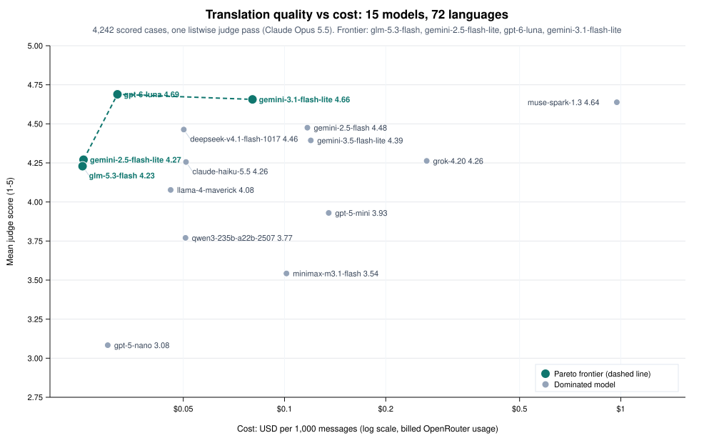

# Pareto translation eval

Full run: 72 non-English languages, up to 40 benchmark and 20 chat cases each (fewer when the source set is shorter), 12 models, one judge (`anthropic/claude-opus-5.5`).

## Method

Cases: 4245 (2805 benchmark, 1440 chat) across 72 languages.
Scored cases: 4245. Judge parse failures: 0.
Benchmark items are English→xx samples from WMT24++ where available (social and speech preferred, then shorter segments), else NTREX-128, else Tatoeba. FLORES+ is gated on Hugging Face and was not downloaded. Languages with fewer than 40 clean segments use every available segment; counts are in `data/coverage.json`.
Chat items are synthetic multi-turn conversations drafted by Claude Opus 5.5. The pilot's chat cases are kept and extended, not replaced.
Each candidate used the interpreter system prompt in `eval/prompts/v1.txt` with conversation history on chat items.
One judge, `anthropic/claude-opus-5.5`, scored shuffled anonymous candidates in compact `m,n,h,c` strings. The reference was shown for benchmark items only.
Bootstrap 95% intervals resample languages, then cases within language (2,000 draws, seed 20261025). Language means are equally weighted.
A model is on the Pareto frontier unless another model is **clearly better** (paired bootstrap CI of the difference is entirely positive) **and** the worse model is not cheaper.
USD / 1k is billed OpenRouter `usage.cost` on successful translation calls, including reasoning tokens, times 1,000. It does not include the judge or the chat drafter.
A cheap model costs at most $0.10 per 1,000 messages. A language is flagged when any cheap model has mean below 3.5 or a critical rate above 25% on that language.

## Quality against cost

| Model | Mean | 95% CI | Critical | USD / 1k | n |
| --- | ---: | --- | ---: | ---: | ---: |
| `google/gemini-3.1-flash-lite` | 4.73 | 4.70–4.76 | 0.9% | $0.080 | 4245 |
| `google/gemini-2.5-flash` | 4.59 | 4.56–4.62 | 1.7% | $0.117 | 4245 |
| `deepseek/deepseek-v4.1-flash-1017` | 4.56 | 4.51–4.61 | 2.7% | $0.050 | 4245 |
| `google/gemini-3.5-flash-lite` | 4.49 | 4.44–4.53 | 2.9% | $0.120 | 4245 |
| `google/gemini-2.5-flash-lite` | 4.38 | 4.32–4.43 | 4.5% | $0.025 | 4245 |
| `x-ai/grok-4.20` | 4.36 | 4.31–4.41 | 3.4% | $0.265 | 4245 |
| `anthropic/claude-haiku-5.5` | 4.35 | 4.28–4.42 | 4.2% | $0.051 | 4245 |
| `meta-llama/llama-4-maverick` | 4.18 | 4.11–4.25 | 5.7% | $0.046 | 4245 |
| `openai/gpt-5-mini` | 4.03 | 3.89–4.15 | 9.2% | $0.135 | 4245 |
| `qwen/qwen3-235b-a22b-2507` | 3.86 | 3.68–4.00 | 14.4% | $0.051 | 4245 |
| `openai/gpt-5-nano` | 3.17 | 3.02–3.32 | 26.1% | $0.030 | 4245 |

## Pareto frontier

- `google/gemini-2.5-flash-lite` — mean 4.38 (4.32–4.43), critical 4.5%, $0.025 / 1k
- `deepseek/deepseek-v4.1-flash-1017` — mean 4.56 (4.51–4.61), critical 2.7%, $0.050 / 1k
- `google/gemini-3.1-flash-lite` — mean 4.73 (4.70–4.76), critical 0.9%, $0.080 / 1k

## Paired differences vs the best model

Best mean: `google/gemini-3.1-flash-lite`.

| Model | Mean − best | 95% CI |
| --- | ---: | --- |
| `google/gemini-2.5-flash` | 0.139 | 0.105–0.173 |
| `deepseek/deepseek-v4.1-flash-1017` | 0.167 | 0.121–0.217 |
| `google/gemini-3.5-flash-lite` | 0.244 | 0.205–0.285 |
| `google/gemini-2.5-flash-lite` | 0.351 | 0.306–0.398 |
| `x-ai/grok-4.20` | 0.366 | 0.318–0.413 |
| `anthropic/claude-haiku-5.5` | 0.377 | 0.324–0.436 |
| `meta-llama/llama-4-maverick` | 0.548 | 0.494–0.605 |
| `openai/gpt-5-mini` | 0.704 | 0.587–0.835 |
| `qwen/qwen3-235b-a22b-2507` | 0.876 | 0.734–1.028 |
| `openai/gpt-5-nano` | 1.558 | 1.407–1.717 |

## Benchmark cases

| Model | Mean | 95% CI | Critical | USD / 1k | n |
| --- | ---: | --- | ---: | ---: | ---: |
| `google/gemini-3.1-flash-lite` | 4.70 | 4.66–4.74 | 0.9% | $0.085 | 2805 |
| `google/gemini-2.5-flash` | 4.54 | 4.49–4.58 | 1.6% | $0.127 | 2805 |
| `deepseek/deepseek-v4.1-flash-1017` | 4.53 | 4.46–4.59 | 2.3% | $0.053 | 2805 |
| `google/gemini-3.5-flash-lite` | 4.40 | 4.33–4.46 | 3.4% | $0.130 | 2805 |
| `google/gemini-2.5-flash-lite` | 4.32 | 4.25–4.39 | 4.3% | $0.026 | 2805 |
| `x-ai/grok-4.20` | 4.31 | 4.24–4.37 | 3.1% | $0.252 | 2805 |
| `anthropic/claude-haiku-5.5` | 4.29 | 4.21–4.37 | 3.8% | $0.055 | 2805 |
| `meta-llama/llama-4-maverick` | 4.10 | 4.02–4.18 | 5.1% | $0.047 | 2805 |
| `openai/gpt-5-mini` | 3.95 | 3.80–4.08 | 9.0% | $0.144 | 2805 |
| `qwen/qwen3-235b-a22b-2507` | 3.73 | 3.53–3.90 | 14.4% | $0.057 | 2805 |
| `openai/gpt-5-nano` | 3.12 | 2.94–3.29 | 25.0% | $0.032 | 2805 |

Best benchmark mean: `google/gemini-3.1-flash-lite`.

| Model | Mean − best | 95% CI |
| --- | ---: | --- |
| `google/gemini-2.5-flash` | 0.162 | 0.120–0.206 |
| `deepseek/deepseek-v4.1-flash-1017` | 0.170 | 0.111–0.240 |
| `google/gemini-3.5-flash-lite` | 0.300 | 0.248–0.350 |
| `google/gemini-2.5-flash-lite` | 0.379 | 0.326–0.438 |
| `x-ai/grok-4.20` | 0.394 | 0.335–0.456 |
| `anthropic/claude-haiku-5.5` | 0.414 | 0.346–0.486 |
| `meta-llama/llama-4-maverick` | 0.596 | 0.533–0.662 |
| `openai/gpt-5-mini` | 0.755 | 0.625–0.893 |
| `qwen/qwen3-235b-a22b-2507` | 0.976 | 0.813–1.146 |
| `openai/gpt-5-nano` | 1.579 | 1.412–1.747 |

## Chat cases

| Model | Mean | 95% CI | Critical | USD / 1k | n |
| --- | ---: | --- | ---: | ---: | ---: |
| `google/gemini-3.1-flash-lite` | 4.80 | 4.76–4.83 | 1.0% | $0.070 | 1440 |
| `google/gemini-2.5-flash` | 4.70 | 4.66–4.75 | 1.9% | $0.098 | 1440 |
| `google/gemini-3.5-flash-lite` | 4.66 | 4.61–4.71 | 1.9% | $0.099 | 1440 |
| `deepseek/deepseek-v4.1-flash-1017` | 4.64 | 4.59–4.69 | 3.3% | $0.044 | 1440 |
| `anthropic/claude-haiku-5.5` | 4.49 | 4.41–4.57 | 4.9% | $0.042 | 1440 |
| `google/gemini-2.5-flash-lite` | 4.49 | 4.42–4.56 | 4.9% | $0.023 | 1440 |
| `x-ai/grok-4.20` | 4.47 | 4.41–4.54 | 4.0% | $0.289 | 1440 |
| `meta-llama/llama-4-maverick` | 4.34 | 4.25–4.43 | 7.1% | $0.044 | 1440 |
| `openai/gpt-5-mini` | 4.18 | 4.05–4.30 | 9.5% | $0.118 | 1440 |
| `qwen/qwen3-235b-a22b-2507` | 4.10 | 3.94–4.25 | 14.6% | $0.039 | 1440 |
| `openai/gpt-5-nano` | 3.29 | 3.12–3.45 | 28.4% | $0.026 | 1440 |

Best chat mean: `google/gemini-3.1-flash-lite`.

| Model | Mean − best | 95% CI |
| --- | ---: | --- |
| `google/gemini-2.5-flash` | 0.092 | 0.044–0.141 |
| `google/gemini-3.5-flash-lite` | 0.134 | 0.082–0.188 |
| `deepseek/deepseek-v4.1-flash-1017` | 0.156 | 0.103–0.206 |
| `anthropic/claude-haiku-5.5` | 0.301 | 0.233–0.375 |
| `google/gemini-2.5-flash-lite` | 0.300 | 0.237–0.364 |
| `x-ai/grok-4.20` | 0.322 | 0.256–0.384 |
| `meta-llama/llama-4-maverick` | 0.456 | 0.379–0.536 |
| `openai/gpt-5-mini` | 0.613 | 0.493–0.742 |
| `qwen/qwen3-235b-a22b-2507` | 0.691 | 0.558–0.831 |
| `openai/gpt-5-nano` | 1.507 | 1.345–1.675 |

## Per language

| Language | gemini-3.1-flash-lite | gemini-2.5-flash | deepseek-v4.1-flash-1017 | gemini-3.5-flash-lite | gemini-2.5-flash-lite | grok-4.20 | claude-haiku-5.5 | llama-4-maverick | gpt-5-mini | qwen3-235b-a22b-2507 | gpt-5-nano |
| --- | ---: | ---: | ---: | ---: | ---: | ---: | ---: | ---: | ---: | ---: | ---: |
| af | 4.80 | 4.73 | 4.84 | 4.61 | 4.67 | 4.68 | 4.71 | 4.62 | 4.42 | 4.37 | 3.96 |
| am | 4.68 | 4.56 | 4.42 | 4.41 | 4.17 | 4.05 | 4.46 | 4.11 | 2.77 | 2.22 | 1.61 |
| ar | 4.86 | 4.62 | 4.77 | 4.54 | 4.50 | 4.46 | 4.47 | 4.31 | 4.47 | 4.18 | 3.68 |
| as | 4.77 | 4.52 | 4.44 | 4.29 | 4.13 | 4.24 | 3.74 | 4.28 | 3.44 | 4.00 | 2.62 |
| az | 4.84 | 4.73 | 4.66 | 4.65 | 4.44 | 4.65 | 4.24 | 4.36 | 4.26 | 4.18 | 3.37 |
| bg | 4.82 | 4.51 | 4.68 | 4.56 | 4.36 | 4.57 | 4.42 | 4.27 | 4.47 | 4.19 | 3.41 |
| bho | 4.69 | 4.78 | 4.41 | 4.44 | 4.47 | 4.26 | 4.53 | 4.08 | 4.11 | 3.03 | 3.41 |
| bn | 4.79 | 4.58 | 4.66 | 4.50 | 4.50 | 4.46 | 4.54 | 4.32 | 3.73 | 4.30 | 2.75 |
| ca | 4.76 | 4.41 | 4.59 | 4.51 | 4.45 | 4.48 | 4.40 | 4.26 | 4.34 | 4.25 | 3.59 |
| ceb | 4.41 | 4.41 | 4.36 | 4.14 | 4.11 | 3.81 | 3.84 | 3.71 | 3.92 | 3.51 | 3.07 |
| cs | 4.71 | 4.57 | 4.58 | 4.58 | 4.46 | 4.41 | 4.36 | 4.08 | 4.32 | 4.13 | 3.43 |
| da | 4.79 | 4.67 | 4.69 | 4.46 | 4.59 | 4.57 | 4.37 | 4.39 | 4.44 | 4.37 | 3.94 |
| de | 4.77 | 4.58 | 4.72 | 4.74 | 4.55 | 4.51 | 4.69 | 4.45 | 4.52 | 4.63 | 4.09 |
| el | 4.80 | 4.64 | 4.59 | 4.39 | 4.58 | 4.56 | 4.47 | 4.37 | 4.51 | 4.02 | 3.59 |
| es | 4.85 | 4.72 | 4.66 | 4.72 | 4.52 | 4.63 | 4.61 | 4.52 | 4.62 | 4.54 | 4.26 |
| fa | 4.81 | 4.72 | 4.57 | 4.52 | 4.54 | 4.59 | 4.41 | 4.24 | 4.36 | 4.08 | 3.37 |
| fi | 4.79 | 4.64 | 4.71 | 4.41 | 4.44 | 4.11 | 4.21 | 4.06 | 4.28 | 3.99 | 3.44 |
| fr | 4.71 | 4.40 | 4.64 | 4.63 | 4.51 | 4.64 | 4.66 | 4.42 | 4.62 | 4.41 | 4.07 |
| gu | 4.77 | 4.72 | 4.62 | 4.49 | 4.45 | 4.39 | 4.62 | 4.37 | 3.41 | 4.17 | 2.12 |
| ha | 4.70 | 4.49 | 4.53 | 4.34 | 4.18 | 4.05 | 4.33 | 3.72 | 4.14 | 1.88 | 3.16 |
| he | 4.76 | 4.52 | 4.62 | 4.43 | 4.55 | 4.54 | 4.39 | 4.19 | 4.11 | 3.65 | 3.20 |
| hi | 4.85 | 4.59 | 4.58 | 4.70 | 4.41 | 4.36 | 4.64 | 4.39 | 4.14 | 4.30 | 3.31 |
| hr | 4.78 | 4.64 | 4.68 | 4.66 | 4.62 | 4.63 | 4.54 | 4.44 | 4.41 | 4.07 | 3.63 |
| hu | 4.62 | 4.46 | 4.59 | 4.12 | 4.08 | 4.38 | 4.23 | 4.19 | 3.99 | 3.95 | 3.16 |
| hy | 4.79 | 4.67 | 4.66 | 4.72 | 4.34 | 4.42 | 4.54 | 4.39 | 3.74 | 3.99 | 2.69 |
| id | 4.72 | 4.54 | 4.69 | 4.63 | 4.59 | 4.53 | 4.66 | 4.39 | 4.49 | 4.57 | 3.80 |
| ig | 4.46 | 4.32 | 4.50 | 4.18 | 3.67 | 4.09 | 3.24 | 3.49 | 3.63 | 2.08 | 2.90 |
| it | 4.72 | 4.39 | 4.68 | 4.62 | 4.43 | 4.48 | 4.42 | 4.27 | 4.50 | 4.30 | 3.82 |
| ja | 4.70 | 4.59 | 4.71 | 4.73 | 4.39 | 4.42 | 4.44 | 4.26 | 4.57 | 4.42 | 3.76 |
| jv | 4.67 | 4.67 | 4.61 | 4.32 | 4.36 | 4.37 | 4.57 | 4.32 | 4.22 | 4.03 | 3.14 |
| kk | 4.78 | 4.72 | 4.47 | 4.57 | 4.48 | 4.23 | 4.26 | 4.22 | 4.23 | 3.90 | 3.20 |
| km | 4.77 | 4.71 | 4.56 | 4.44 | 4.36 | 4.38 | 4.09 | 4.02 | 3.10 | 3.76 | 2.09 |
| kn | 4.72 | 4.66 | 4.71 | 4.43 | 4.23 | 4.39 | 4.44 | 4.16 | 3.01 | 4.17 | 2.21 |
| ko | 4.76 | 4.71 | 4.73 | 4.74 | 4.42 | 4.49 | 4.30 | 4.27 | 4.43 | 4.47 | 3.51 |
| ku | 4.55 | 4.37 | 4.19 | 4.21 | 3.82 | 3.98 | 3.88 | 3.81 | 2.69 | 2.72 | 1.62 |
| lo | 4.72 | 4.56 | 4.23 | 4.44 | 4.17 | 4.16 | 4.19 | 3.95 | 2.63 | 3.89 | 1.62 |
| ml | 4.73 | 4.74 | 4.60 | 4.58 | 4.48 | 4.23 | 4.64 | 4.27 | 2.77 | 3.87 | 2.13 |
| mr | 4.76 | 4.56 | 4.66 | 4.59 | 4.50 | 4.52 | 4.44 | 4.09 | 3.84 | 4.04 | 2.86 |
| ms | 4.78 | 4.62 | 4.58 | 4.66 | 4.62 | 4.38 | 4.63 | 4.37 | 4.36 | 4.50 | 4.00 |
| my | 4.77 | 4.69 | 4.64 | 4.41 | 4.40 | 4.33 | 4.13 | 4.38 | 3.04 | 4.07 | 1.98 |
| ne | 4.84 | 4.68 | 4.63 | 4.53 | 4.54 | 4.37 | 4.26 | 4.23 | 4.16 | 4.03 | 3.27 |
| nl | 4.86 | 4.72 | 4.68 | 4.60 | 4.55 | 4.51 | 4.55 | 4.57 | 4.52 | 4.41 | 3.84 |
| no | 4.73 | 4.56 | 4.69 | 4.44 | 4.41 | 4.40 | 4.48 | 4.36 | 4.49 | 4.12 | 3.87 |
| or | 4.83 | 4.80 | 4.75 | 4.63 | 4.51 | 4.35 | 4.67 | 4.33 | 3.82 | 4.17 | 2.54 |
| pa | 4.86 | 4.78 | 4.83 | 4.62 | 4.65 | 4.33 | 4.37 | 4.01 | 3.85 | 3.74 | 2.63 |
| pl | 4.90 | 4.68 | 4.44 | 4.69 | 4.48 | 4.34 | 4.36 | 4.30 | 4.59 | 4.12 | 3.77 |
| ps | 4.62 | 4.66 | 4.23 | 4.27 | 4.27 | 3.95 | 3.94 | 4.15 | 4.13 | 2.63 | 3.07 |
| pt | 4.78 | 4.62 | 4.71 | 4.69 | 4.58 | 4.64 | 4.61 | 4.34 | 4.67 | 4.56 | 4.00 |
| ro | 4.79 | 4.62 | 4.70 | 4.57 | 4.28 | 4.65 | 4.52 | 4.38 | 4.30 | 4.16 | 3.64 |
| ru | 4.62 | 4.63 | 4.59 | 4.52 | 4.52 | 4.49 | 4.57 | 4.38 | 4.36 | 4.36 | 3.53 |
| sd | 4.63 | 4.67 | 4.33 | 4.11 | 4.26 | 3.94 | 3.77 | 3.99 | 3.82 | 3.43 | 2.48 |
| si | 4.87 | 4.64 | 4.60 | 4.42 | 4.57 | 3.96 | 4.17 | 4.29 | 3.04 | 3.55 | 2.07 |
| sk | 4.84 | 4.64 | 3.62 | 4.62 | 4.40 | 4.52 | 4.38 | 4.09 | 4.24 | 4.04 | 3.71 |
| so | 4.46 | 4.55 | 4.37 | 4.23 | 4.12 | 4.32 | 3.77 | 3.42 | 4.03 | 2.06 | 3.09 |
| sq | 4.84 | 4.76 | 4.61 | 4.42 | 4.39 | 4.43 | 4.27 | 4.43 | 4.36 | 4.00 | 3.60 |
| sr | 4.71 | 4.61 | 4.61 | 4.59 | 4.27 | 4.48 | 4.28 | 4.32 | 4.23 | 3.81 | 3.24 |
| su | 4.71 | 4.67 | 4.50 | 4.50 | 4.43 | 4.42 | 4.29 | 4.29 | 4.30 | 3.37 | 3.63 |
| sv | 4.71 | 4.78 | 4.64 | 4.51 | 4.51 | 4.48 | 4.41 | 4.29 | 4.56 | 4.23 | 3.83 |
| sw | 4.63 | 4.50 | 4.38 | 4.30 | 4.33 | 4.19 | 4.34 | 3.74 | 3.82 | 2.77 | 2.60 |
| ta | 4.73 | 4.63 | 4.62 | 4.53 | 4.47 | 4.27 | 4.61 | 4.30 | 3.00 | 4.03 | 1.90 |
| te | 4.73 | 4.66 | 4.74 | 4.56 | 4.51 | 4.33 | 4.57 | 4.22 | 3.28 | 3.79 | 2.31 |
| th | 4.72 | 4.44 | 4.49 | 4.53 | 4.32 | 4.27 | 4.33 | 4.22 | 4.05 | 4.19 | 3.36 |
| tl | 4.70 | 4.41 | 4.48 | 4.31 | 4.42 | 4.26 | 4.49 | 3.96 | 4.09 | 3.71 | 3.38 |
| tr | 4.76 | 4.56 | 4.62 | 4.46 | 4.34 | 4.43 | 4.37 | 4.12 | 4.36 | 4.10 | 3.44 |
| uk | 4.86 | 4.59 | 4.77 | 4.56 | 4.46 | 4.56 | 4.51 | 4.23 | 4.54 | 4.08 | 3.74 |
| ur | 4.65 | 4.44 | 4.31 | 4.46 | 4.31 | 4.32 | 4.38 | 3.91 | 4.04 | 3.96 | 3.02 |
| uz | 4.81 | 4.71 | 4.59 | 4.51 | 4.44 | 4.41 | 4.22 | 4.32 | 4.32 | 3.88 | 3.36 |
| vi | 4.67 | 4.37 | 4.63 | 4.74 | 4.36 | 4.30 | 4.48 | 4.10 | 4.34 | 4.48 | 3.57 |
| yo | 4.63 | 4.26 | 4.04 | 4.06 | 3.66 | 4.02 | 4.34 | 3.26 | 3.19 | 1.85 | 2.34 |
| zh-CN | 4.67 | 4.52 | 4.70 | 4.55 | 4.44 | 4.53 | 4.41 | 4.26 | 4.47 | 4.68 | 3.83 |
| zh-HK | 4.73 | 4.52 | 4.62 | 4.55 | 4.46 | 4.29 | 4.28 | 4.28 | 4.16 | 4.01 | 3.57 |
| zu | 4.23 | 4.16 | 4.23 | 3.85 | 3.56 | 4.01 | 3.65 | 3.19 | 3.61 | 2.16 | 2.46 |

## Language flags

46 languages where a cheap model scores badly.

| Language | Model | Mean | Critical | n | Reason |
| --- | --- | ---: | ---: | ---: | --- |
| am | `openai/gpt-5-nano` | 1.61 | 78.3% | 60 | mean<3.5, critical>25% |
| am | `qwen/qwen3-235b-a22b-2507` | 2.22 | 70.0% | 60 | mean<3.5, critical>25% |
| as | `openai/gpt-5-nano` | 2.62 | 43.3% | 60 | mean<3.5, critical>25% |
| az | `openai/gpt-5-nano` | 3.37 | 16.7% | 60 | mean<3.5 |
| bg | `openai/gpt-5-nano` | 3.41 | 8.3% | 60 | mean<3.5 |
| bho | `qwen/qwen3-235b-a22b-2507` | 3.03 | 16.7% | 30 | mean<3.5 |
| bho | `openai/gpt-5-nano` | 3.41 | 16.7% | 30 | mean<3.5 |
| bn | `openai/gpt-5-nano` | 2.75 | 26.7% | 60 | mean<3.5, critical>25% |
| ceb | `openai/gpt-5-nano` | 3.07 | 26.7% | 60 | mean<3.5, critical>25% |
| cs | `openai/gpt-5-nano` | 3.43 | 15.0% | 60 | mean<3.5 |
| fa | `openai/gpt-5-nano` | 3.37 | 16.7% | 60 | mean<3.5 |
| fi | `openai/gpt-5-nano` | 3.44 | 18.3% | 60 | mean<3.5 |
| gu | `openai/gpt-5-nano` | 2.12 | 56.7% | 60 | mean<3.5, critical>25% |
| ha | `qwen/qwen3-235b-a22b-2507` | 1.88 | 78.3% | 60 | mean<3.5, critical>25% |
| ha | `openai/gpt-5-nano` | 3.16 | 23.3% | 60 | mean<3.5 |
| he | `openai/gpt-5-nano` | 3.20 | 23.3% | 60 | mean<3.5 |
| hi | `openai/gpt-5-nano` | 3.31 | 16.7% | 60 | mean<3.5 |
| hu | `openai/gpt-5-nano` | 3.16 | 18.3% | 60 | mean<3.5 |
| hy | `openai/gpt-5-nano` | 2.69 | 35.0% | 60 | mean<3.5, critical>25% |
| ig | `qwen/qwen3-235b-a22b-2507` | 2.08 | 66.7% | 60 | mean<3.5, critical>25% |
| ig | `openai/gpt-5-nano` | 2.90 | 43.3% | 60 | mean<3.5, critical>25% |
| ig | `anthropic/claude-haiku-5.5` | 3.24 | 26.7% | 60 | mean<3.5, critical>25% |
| ig | `meta-llama/llama-4-maverick` | 3.49 | 23.3% | 60 | mean<3.5 |
| jv | `openai/gpt-5-nano` | 3.14 | 35.0% | 60 | mean<3.5, critical>25% |
| kk | `openai/gpt-5-nano` | 3.20 | 23.3% | 60 | mean<3.5 |
| km | `openai/gpt-5-nano` | 2.09 | 38.3% | 60 | mean<3.5, critical>25% |
| kn | `openai/gpt-5-nano` | 2.21 | 40.0% | 60 | mean<3.5, critical>25% |
| ku | `openai/gpt-5-nano` | 1.62 | 73.3% | 60 | mean<3.5, critical>25% |
| ku | `qwen/qwen3-235b-a22b-2507` | 2.72 | 38.3% | 60 | mean<3.5, critical>25% |
| lo | `openai/gpt-5-nano` | 1.62 | 75.0% | 60 | mean<3.5, critical>25% |
| ml | `openai/gpt-5-nano` | 2.13 | 56.7% | 60 | mean<3.5, critical>25% |
| mr | `openai/gpt-5-nano` | 2.86 | 23.3% | 60 | mean<3.5 |
| my | `openai/gpt-5-nano` | 1.98 | 56.7% | 60 | mean<3.5, critical>25% |
| ne | `openai/gpt-5-nano` | 3.27 | 20.0% | 60 | mean<3.5 |
| or | `openai/gpt-5-nano` | 2.54 | 51.2% | 41 | mean<3.5, critical>25% |
| pa | `openai/gpt-5-nano` | 2.63 | 38.3% | 60 | mean<3.5, critical>25% |
| pa | `qwen/qwen3-235b-a22b-2507` | 3.74 | 28.3% | 60 | critical>25% |
| ps | `qwen/qwen3-235b-a22b-2507` | 2.63 | 40.0% | 60 | mean<3.5, critical>25% |
| ps | `openai/gpt-5-nano` | 3.07 | 28.3% | 60 | mean<3.5, critical>25% |
| sd | `openai/gpt-5-nano` | 2.48 | 40.0% | 60 | mean<3.5, critical>25% |
| sd | `qwen/qwen3-235b-a22b-2507` | 3.43 | 20.0% | 60 | mean<3.5 |
| si | `openai/gpt-5-nano` | 2.07 | 61.7% | 60 | mean<3.5, critical>25% |
| sk | `deepseek/deepseek-v4.1-flash-1017` | 3.62 | 31.7% | 60 | critical>25% |
| so | `qwen/qwen3-235b-a22b-2507` | 2.06 | 68.3% | 60 | mean<3.5, critical>25% |
| so | `openai/gpt-5-nano` | 3.09 | 26.7% | 60 | mean<3.5, critical>25% |
| so | `meta-llama/llama-4-maverick` | 3.42 | 16.7% | 60 | mean<3.5 |
| sr | `openai/gpt-5-nano` | 3.24 | 21.7% | 60 | mean<3.5 |
| su | `qwen/qwen3-235b-a22b-2507` | 3.37 | 23.5% | 34 | mean<3.5 |
| sw | `openai/gpt-5-nano` | 2.60 | 45.0% | 60 | mean<3.5, critical>25% |
| sw | `qwen/qwen3-235b-a22b-2507` | 2.77 | 46.7% | 60 | mean<3.5, critical>25% |
| ta | `openai/gpt-5-nano` | 1.90 | 70.0% | 60 | mean<3.5, critical>25% |
| te | `openai/gpt-5-nano` | 2.31 | 51.7% | 60 | mean<3.5, critical>25% |
| te | `qwen/qwen3-235b-a22b-2507` | 3.79 | 31.7% | 60 | critical>25% |
| th | `openai/gpt-5-nano` | 3.36 | 23.3% | 60 | mean<3.5 |
| tl | `openai/gpt-5-nano` | 3.38 | 18.3% | 60 | mean<3.5 |
| tr | `openai/gpt-5-nano` | 3.44 | 20.0% | 60 | mean<3.5 |
| ur | `openai/gpt-5-nano` | 3.02 | 31.7% | 60 | mean<3.5, critical>25% |
| uz | `openai/gpt-5-nano` | 3.36 | 18.3% | 60 | mean<3.5 |
| yo | `qwen/qwen3-235b-a22b-2507` | 1.85 | 71.7% | 60 | mean<3.5, critical>25% |
| yo | `openai/gpt-5-nano` | 2.34 | 38.3% | 60 | mean<3.5, critical>25% |
| yo | `meta-llama/llama-4-maverick` | 3.26 | 13.3% | 60 | mean<3.5 |
| zu | `qwen/qwen3-235b-a22b-2507` | 2.16 | 63.3% | 60 | mean<3.5, critical>25% |
| zu | `openai/gpt-5-nano` | 2.46 | 51.7% | 60 | mean<3.5, critical>25% |
| zu | `meta-llama/llama-4-maverick` | 3.19 | 26.7% | 60 | mean<3.5, critical>25% |

## Spend

Spend (OpenRouter `usage.cost`, hard cap $41.00, soft stop $40.00): **$39.7087**.

| Step | USD |
| --- | ---: |
| Chat drafting | $10.6700 |
| Translations | $5.2296 |
| Judge | $23.8112 |
| Total | $39.7087 |

Measured cost per case (all models + share of drafting and judging): **$0.0094**.
Measured translation cost per model×case: **$0.00010**.

## Limits

LLM-judged, not human-verified. A single Opus judge can favor its own family. Per-language cells are noisy at this sample size. WMT24++ locales (for example Mexican Spanish, Egyptian Arabic) stand in for the language, not every variety.
